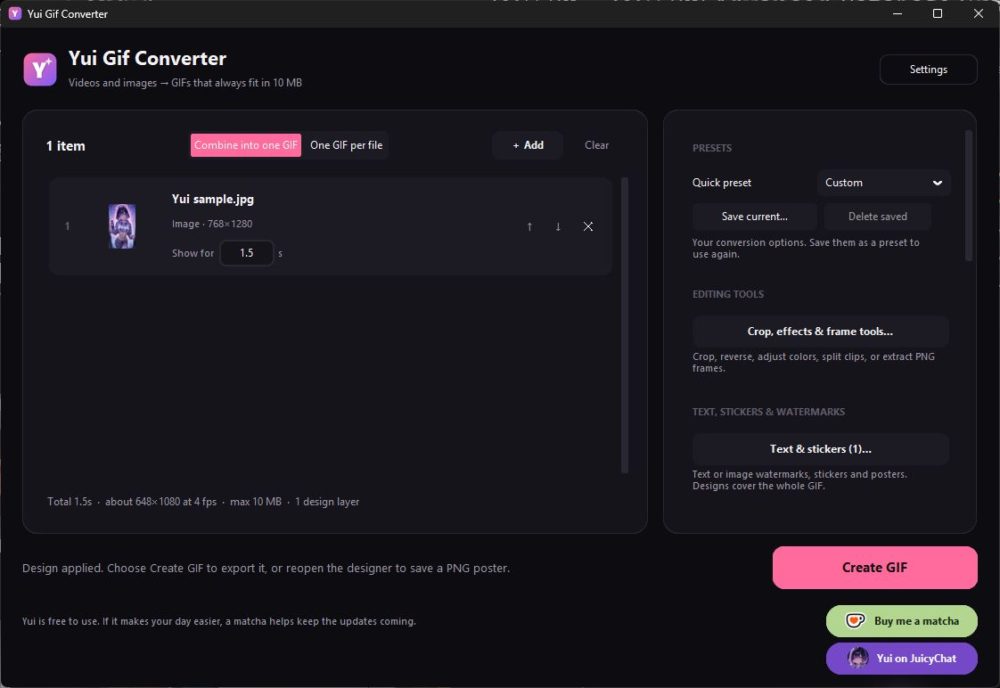
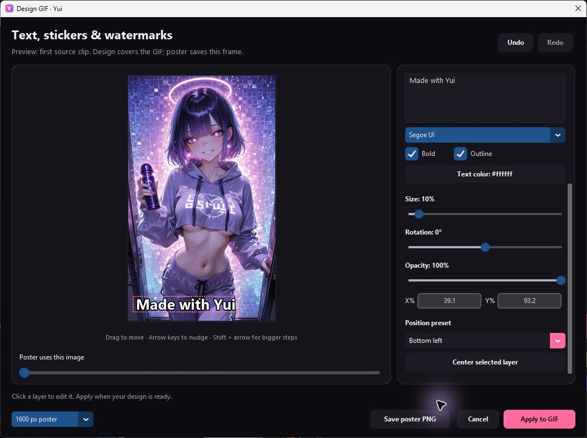
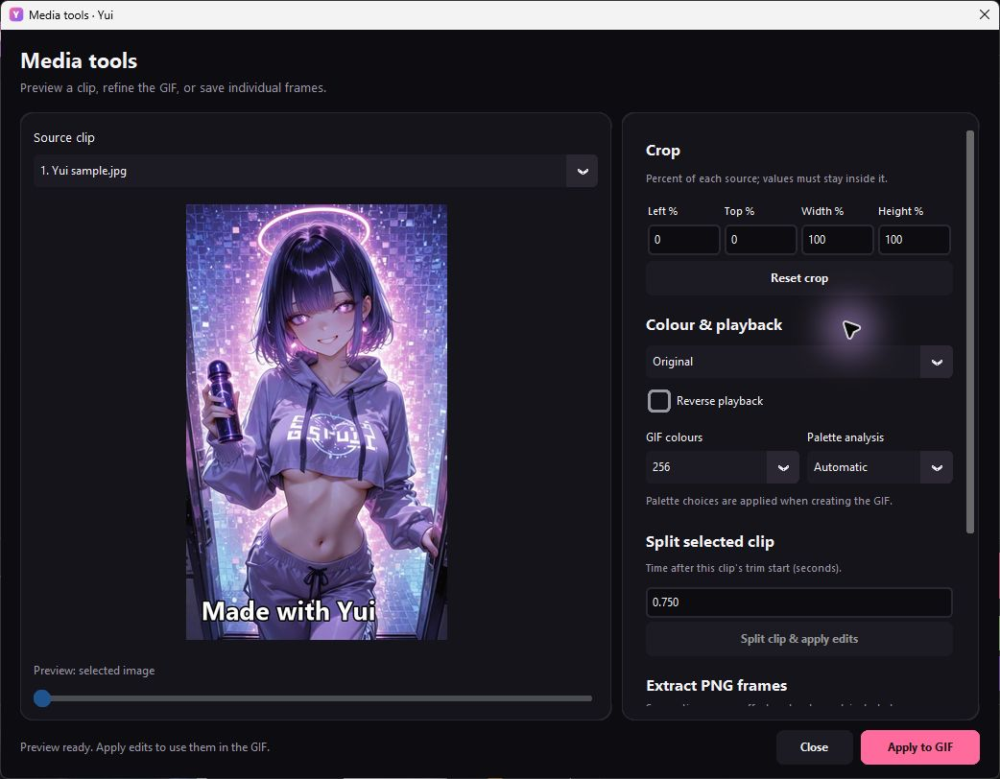

<p align="center">
  
</p>

<h1 align="center">Yui GIF Converter</h1>

<p align="center">
  <strong>Small GIFs. Big personality.</strong><br>
  Turn videos and images into GIFs. Add your own text, stickers, and finishing touches.
</p>

<p align="center">
  Free to use &nbsp;·&nbsp; Works offline &nbsp;·&nbsp; Windows 10 / 11 &nbsp;·&nbsp; Portable
</p>

<p align="center">
  <a href="https://github.com/Yuixxxxx/yui-gif-converter/releases/download/v1.6.0/YuiGifConverter-1.6.0-full-package.zip"></a>
  <a href="yui/"></a>
</p>

<p align="center">
  <sub>v1.6.0 &nbsp;·&nbsp; 59.6 MB ZIP (56.8 MiB) &nbsp;·&nbsp; Windows x64</sub><br>
  <a href="docs/USER_GUIDE.md">User guide</a> &nbsp;·&nbsp;
  <a href="https://github.com/Yuixxxxx/yui-gif-converter/releases/tag/v1.6.0">Release notes</a> &nbsp;·&nbsp;
  <a href="docs/DEVELOPMENT.md">Build from source</a>
</p>

<p align="center">
  <a href="docs/images/yui-main.jpg"></a>
  <br><sub>The actual Yui app. Click any screenshot to see it full size.</sub>
</p>

## From clip to something worth sharing

| Make it | Make it yours | Make it fit |
| :--- | :--- | :--- |
| **Videos → GIFs** and **images → GIFs** | Text, image stickers, and watermarks | Measured output limits up to **10 MiB** |
| Combine files or export a GIF for each | Crop, resize, effects, and reverse | Frame rate, speed, and palette controls |
| Trim clips, split segments, and extract PNG frames | Save a still **PNG poster** | Reusable conversion presets |

## A little creative freedom

<table>
  <tr>
    <td width="50%" align="center">
      <a href="docs/images/yui-designer.jpg"></a><br>
      <strong>Text, stickers &amp; watermarks</strong><br>
      <sub>Place layers, adjust their look, or save a poster.</sub>
    </td>
    <td width="50%" align="center">
      <a href="docs/images/yui-tools.jpg"></a><br>
      <strong>Crop, colour &amp; frame tools</strong><br>
      <sub>Refine a clip before turning it into a GIF.</sub>
    </td>
  </tr>
</table>

## Download. Extract. Create.

1. **[Download Yui for Windows](https://github.com/Yuixxxxx/yui-gif-converter/releases/download/v1.6.0/YuiGifConverter-1.6.0-full-package.zip)** and extract the ZIP.
2. Open **`YuiGifConverter.exe`** and review the first-launch terms.
3. Drop in videos or images, adjust your options, and choose **Create GIF**.
4. Preview your result, then save or copy it to share.

Python and FFmpeg are included in the portable app. The EXE is currently unsigned,
so Windows may show an unknown-publisher warning.

| Before you download | Requirements |
| :--- | :--- |
| Operating system | Windows 10 or 11, 64-bit |
| Processor | Intel or AMD x64 |
| Memory | 4 GB or more recommended; needs vary with media |
| Free storage | Allow 250 MB to download, extract, and open, plus space for media and exports |

For websites with a decimal **10 MB** upload limit, choose Yui's **8 MB** preset.
The full [user guide](docs/USER_GUIDE.md) covers editing, shortcuts, and troubleshooting.

## Your files stay on your computer

Conversion runs locally and requires no account or media upload. Original files
are preserved. See the [privacy and local-data details](docs/USER_GUIDE.md#files-and-privacy)
for settings, output folders, and clipboard behavior.

## Inspect the code

The actual **1.6.0 application source**, tests, artwork, and build tools are here
as normal Git files. Start with [app.py](app.py), the [application modules](yui/),
or the [build script](build.ps1).

```sh
git clone https://github.com/Yuixxxxx/yui-gif-converter.git
cd yui-gif-converter
```

<details>
<summary><strong>Run or build Yui yourself</strong></summary>

Follow [Development](docs/DEVELOPMENT.md) for the complete setup, FFmpeg preparation,
and build steps. Building uses Windows x64, Python 3.14.8 or a newer Python 3.14
maintenance version, and the pinned requirements files.

The original `v1.6.0` tag predates source publication. Use **`main`** for the
complete application source; the release also retains a source ZIP snapshot.

</details>

<details>
<summary><strong>Check the source and published download</strong></summary>

All **19 application files** compile to the same Python code objects as those
embedded in the published 1.6.0 EXE, after normalizing source filenames.
[Verification](docs/VERIFICATION.md) explains the comparison and its limits.
[SOURCE_MANIFEST.json](SOURCE_MANIFEST.json) records individual file hashes and
the binary used.

```powershell
python tools\verify_source.py
# Optional, using Python 3.14 and the build requirements:
python tools\verify_source.py --exe .\YuiGifConverter.exe
```

The optional comparison reads the EXE as data without executing it. It does not
establish a full binary audit or a bit-for-bit reproducible build.

SHA-256 of the **Windows ZIP**:

```text
3217a1951071cf3cf81ea4ad07596fc902f8f15754adac229df9c1c97646ed96
```

</details>

## A matcha is optional

Yui is free to use. If it makes your day easier, a little support helps keep
the updates coming.

<table align="center">
  <tr>
    <td width="50%" align="center">
      <a href="https://ko-fi.com/yui_xxx"></a><br>
      <a href="https://ko-fi.com/yui_xxx"><strong>Buy&nbsp;me&nbsp;a&nbsp;matcha&nbsp;↗</strong></a><br>
      <sub>Optional support on Ko-fi</sub>
    </td>
    <td width="50%" align="center">
      <a href="https://www.juicychat.ai/userdetailspace/1933409514837725186"></a><br>
      <a href="https://www.juicychat.ai/userdetailspace/1933409514837725186"><strong>Yui&nbsp;on&nbsp;JuicyChat&nbsp;↗</strong></a><br>
      <sub>Visit the creator profile</sub>
    </td>
  </tr>
</table>

---

<sub>© 2026 Yui. Application source is published under the existing
<a href="LICENSE.txt">application terms</a>; this does not select a new open-source
license. Third-party components retain their own <a href="legal/">licenses and
notices</a>, with corresponding FFmpeg source in <a href="vendor/">vendor/</a>.</sub>
